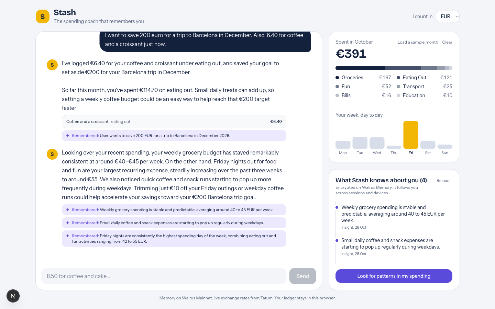

# Stash: the spending coach that remembers you

Stash is a chat-first spending coach for students living abroad. You tell it what you spent the way you'd text a friend, in any currency. It logs the purchase, converts it to your home currency with live rates, and, most importantly, **remembers you**: your goals, budgets, habits and the patterns it notices in your spending. Every week it gets a little sharper, because what it learns lives in **Walrus Memory** on Mainnet, not in a chat window that forgets you when you close it.

Built for **Total Recall, the Tatum x Walrus Memory Hackathon** (Smart Agents for Real Life / Consumer Finance).



## Why

I'm an Erasmus student. My money is split across euros and lira, and every budgeting app I tried either wanted me to categorise every receipt by hand or forgot everything I told it last week. Stash is the coach I wanted: low effort to log, and it actually remembers that I'm saving for Barcelona and that my Fridays get expensive.

## What it does

- **Log by talking.** "12 euro lunch and 250 TL on a gift for mom" becomes two ledger entries, categorised, with the lira converted to euros at the live rate.
- **Remembers what matters.** Goals ("save €200 for Barcelona"), budgets ("stay under €900 a month"), habits and preferences are saved to Walrus Memory, encrypted and tied to the user.
- **Uses what it remembers.** Before giving advice, the agent recalls relevant memories, so answers reference your actual goals instead of generic tips.
- **Learns from your spending.** "Look for patterns in my spending" reviews the ledger against what Stash already knows, finds new patterns (for example *Friday nights are your most expensive day and creeping up*), and writes them back to memory as insights. The next conversation uses them.
- **Shows its memory.** The side panel lists everything Stash knows about you, straight from Walrus. New memories appear the moment they're learned.

## How the learning loop works

```
 you ──"6.40 for coffee, saving for Barcelona"──▶ agent
                                                   │
          ┌────────── tools ───────────────────────┤
          │ log_expense      → Tatum rate API (EUR/TRY/USD…)
          │ recall_memory    → Walrus Memory recall (per-user namespace)
          │ remember         → Walrus Memory remember (goal/habit/insight…)
          │ budget_status    → totals by category and weekday
          │ convert_currency → Tatum rate API
          └────────────────────────────────────────┘
                                                   │
 reflect ──ledger + recalled memories──▶ agent ──▶ new insights ──▶ Walrus
                                                   │
 next chat ◀────────── recall uses those insights ─┘
```

Memories are short, self-contained sentences tagged with a kind (`goal`, `budget`, `habit`, `preference`, `insight`, `context`), so recall stays precise and the panel can group them. Each browser gets its own namespace on Walrus, so memories carry across sessions without an account.

## Stack

| Part | What it does |
| --- | --- |
| **Walrus Memory** (`@mysten-incubation/memwal`, Mainnet relayer) | Long-term, encrypted, per-user memory: `remember`, `recall` with relevance and recency ordering |
| **Tatum Data API** (`/v4/data/rate/symbol`) | Live fiat exchange rates for multi-currency logging and conversion, cached for 10 minutes |
| **Agent** | Tool-calling LLM. Runs on Google Gemini's free tier by default; switches to Claude when `ANTHROPIC_API_KEY` is set |
| **App** | Next.js 15 (App Router), TypeScript, Tailwind CSS v4 |

The ledger itself stays in the browser (localStorage); only distilled knowledge goes to memory. That keeps memory meaningful (no "spent €3.20 on a bus ticket" noise) and keeps raw transactions private.

## Run it locally

Requires Node 22.23+ (see `.nvmrc`).

```bash
git clone <this repo>
cd stash
npm install
cp .env.example .env.local   # then fill in the keys below
npm run dev
```

| Variable | Where to get it |
| --- | --- |
| `MEMWAL_ACCOUNT_ID`, `MEMWAL_KEY` | [memory.walrus.xyz](https://memory.walrus.xyz): create an account and a delegate key |
| `TATUM_API_KEY` | [dashboard.tatum.io](https://dashboard.tatum.io) |
| `GEMINI_API_KEY` | [aistudio.google.com/apikey](https://aistudio.google.com/apikey) (free tier) |
| `ANTHROPIC_API_KEY` | Optional. Used instead of Gemini when `GEMINI_API_KEY` is empty |

Open http://localhost:3000, click **Load a sample month** to get a month of realistic Erasmus spending, then chat or click **Look for patterns in my spending**.

## Project layout

```
src/
  app/
    page.tsx              UI shell and state
    api/chat              agent turn
    api/reflect           pattern-finding pass that writes insights
    api/memories          what Stash knows (Walrus recall, newest first)
    api/rate              Tatum exchange rate passthrough
  components/             ChatPanel, MonthPanel, MemoryPanel
  lib/
    memory.ts             Walrus Memory client and namespaces
    rates.ts              Tatum exchange rates with caching
    tools.ts              provider-neutral agent tools
    llm/gemini.ts         Gemini tool-calling loop
    llm/claude.ts         Claude tool runner
    agent.ts              picks the provider, runs chat and reflection
    rateLimit.ts          per-visitor limits for the public demo
```

## Limits and next steps

- Memory scope is per browser. A sign-in would let one person share memory across devices on purpose.
- Reflection runs on demand. A weekly scheduled reflection would make the learning loop fully automatic.
- Bank or card import would remove manual logging entirely; Stash would still be the part that remembers.

## License

MIT
